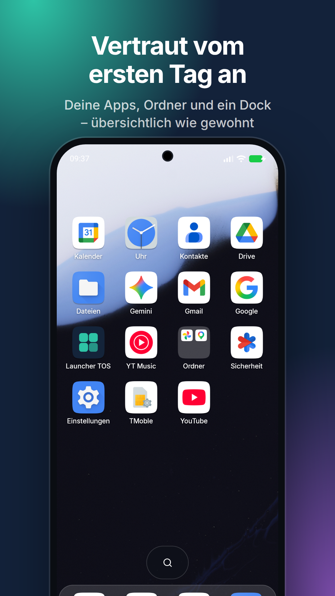
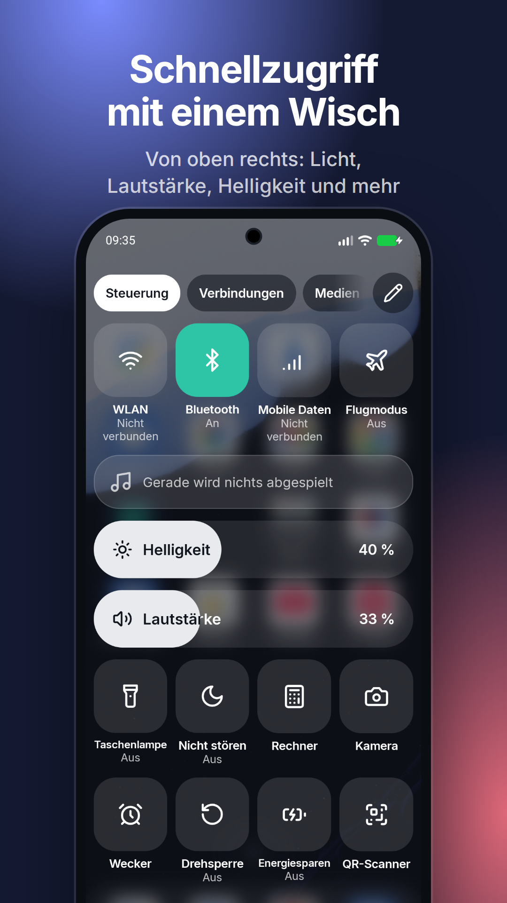
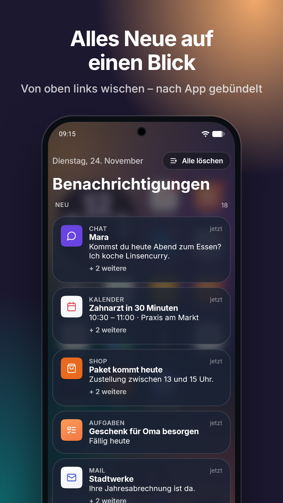
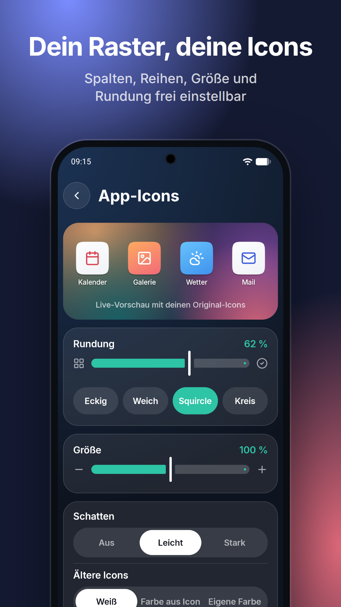

# Launcher TOS

Ein Homescreen für Menschen, die von einem anderen Smartphone-System zu Android wechseln:
vertraut, aufgeräumt und einfach zu bedienen, mit eigener Optik. Fast alles ist einstellbar, die
Standardwerte funktionieren aber ohne Einrichtung. Freie Software (GPLv3), kein Internetzugriff,
keine Werbung, keine Datenerhebung.

**[Download: neueste Version](https://github.com/ra5on/Launcher-TOS/releases/latest)** · Android 8.0 oder neuer

<p>
  
  
  
  
</p>

## Funktionen

**Homescreen**
- Mehrere Seiten mit Raster (3–7 Spalten, 4–9 Reihen), Seitenrand, Abstand oben/unten,
  Seitenanzahl automatisch oder fest, Seitenindikator (Punkte, Balken, Zahl, aus) mit Lupe für die Suche.
- Seitenübergänge Schieben, Stapeln, Blenden, Würfel; Endlos blättern (optional).
- Dock mit 3–6 Apps, Hintergrund Glas/einfarbig/transparent, Rundung einstellbar.
- Original-Icons aller Apps (auch Arbeitsprofil) mit Squircle-Maske (Rundung 0–100 %), Größe,
  Schatten, Hintergrund für ältere Icons (Weiß, Farbe aus Icon, eigene Farbe), Themen-Icons (einfarbig, ab Android 13).
- Beschriftung je Bereich an/aus, Schriftgröße, -stärke, Zeilen, Textschatten, Schriftfarbe.
- Badges (Zahl oder Punkt, Rot/Akzent/Farbe aus Icon, pro App abschaltbar, Ordner zeigen die Summe).
- Widgets auf einer eigenen Seite ganz links und im Raster (belegen mehrere Zellen).

**Bearbeiten**
- Lange drücken: Icons wackeln und lassen sich ziehen; die anderen Icons weichen aus.
  Mitte auf ein Icon = Ordner, sonst einschieben; ein volles Dock verdrängt ins Raster;
  am Rand verweilen wechselt die Seite. „–“ nimmt vom Homescreen (deinstalliert nicht).
- „+“ fügt nicht platzierte Apps hinzu, Widget-Knopf fügt Widgets hinzu, Antippen einer App
  passt Name, einfarbiges Icon und Badge an. Layout sperren verhindert versehentliches Verschieben.
- Ordner mit Vorschau 2×2 oder 3×3, 3–5 Spalten, scrollt bei vielen Apps, Name antippen zum Umbenennen.

**Suche und App-Übersicht**
- Suche als Overlay: findet Apps auch bei Tippfehlern, mit Umlauten/ß, nach Wortanfängen und
  Anfangsbuchstaben; Treffer hervorgehoben; Rechner; Einstellungen als Treffer; zuletzt gesucht/gestartet
  (lokal, abschaltbar, löschbar). Kontakte werden nicht durchsucht.
- App-Übersicht als letzte Seite rechts: Kategorien (aus den Angaben der Apps, plus „Zuletzt installiert“),
  A–Z-Liste mit Buchstaben-Leiste oder Raster. Lange drücken: Zum Homescreen, Anpassen, App-Info,
  Badge an/aus, Ausblenden, Deinstallieren. Versteckte Apps optional mit der Geräte-Sperre geschützt.

**Panels**
- Eigene Benachrichtigungsliste (Neu/Früher, nach App gruppiert, Wischen entfernt, Tippen öffnet, Alle löschen).
- Schnellzugriff mit Seiten (Steuerung, Verbindungen, Medien, eigene), Elemente in S/M/L,
  bearbeitbar: Taschenlampe, Lautstärke, Helligkeit, Drehsperre, Nicht stören, Energiesparen,
  Mediensteuerung mit Cover und Ausgabe-Auswahl, Rechner, Kamera, Wecker, QR (Kamera-App).
- Glas-Flächen, Unschärfe dahinter (ab Android 12), Hintergrund abdunkeln, Akzentfarbe
  (Vorgaben, aus dem Hintergrund, eigene), Hell/Dunkel/System, Kontrast erhöhen.

**Bedienung**
- Haptik (leicht/mittel/stark), Wackeln, Animationsgeschwindigkeit, App-Öffnen-Animation,
  Bewegung reduzieren, einfacher Modus (große Icons und Schrift, weniger Gesten), große Touch-Flächen,
  Statusleiste ausblenden. Kurze Einführung beim ersten Start (wiederholbar).
- Einstellungen mit Suche, Live-Vorschau und „Auf Standard zurücksetzen“ je Seite.
- Layout exportieren/importieren (JSON-Datei) und zurücksetzen.

## Gesten

Der Wisch vom **oberen Rand** (Randzone 24–64 dp unter der Statusleiste) und der Wisch nach unten
in der **Bildschirmmitte** sind getrennte Gesten. Der obere Rand ist geteilt (links/Mitte/rechts,
Breiten 20–50 %) oder ungeteilt.

| Geste | Vorlage „Launcher TOS“ (Standard) |
|---|---|
| Oberer Rand links | eigene Benachrichtigungen |
| Oberer Rand Mitte | Suche |
| Oberer Rand rechts | eigener Schnellzugriff |
| Nach unten wischen (Bildschirmmitte) | Suche |
| Nach oben wischen | nichts |
| Doppeltipp auf leere Fläche | nichts |
| Doppeltipp unten | Assistent |

Weitere Vorlagen: **Android-Standard** (nach unten wischen überall = System-Benachrichtigungen,
nach oben = Suche), **Android + Suche** (oberer Rand = System-Benachrichtigungen, Bildschirmmitte =
Suche) und **Eigen** (jede Geste einzeln: eigene oder System-Benachrichtigungen, eigener Schnellzugriff
oder System-Schnelleinstellungen, Suche, App-Übersicht, App öffnen, Assistent, nichts). Die Suche bleibt
immer über die Lupe im Seitenindikator erreichbar.

## Berechtigungen

Internet nur für Updates von GitHub (abschaltbar). Alle Berechtigungen sind optional und in der App unter „Berechtigungen“ erklärt; die Einrichtung beim ersten Start führt durch die wichtigsten.

| Berechtigung | Wofür |
|---|---|
| Benachrichtigungszugriff (vom Nutzer in den Systemeinstellungen erteilt) | Badges, eigene Benachrichtigungsliste, Mediensteuerung |
| `ACCESS_NOTIFICATION_POLICY` (vom Nutzer erteilt) | „Nicht stören“ im Schnellzugriff schalten |
| `WRITE_SETTINGS` (vom Nutzer erteilt) | Helligkeit und Drehsperre im Schnellzugriff |
| `EXPAND_STATUS_BAR` | System-Benachrichtigungen/-Schnelleinstellungen per Geste aufklappen |
| `ACCESS_NETWORK_STATE` | im Schnellzugriff anzeigen, ob WLAN/Mobile Daten verbunden sind |
| `USE_BIOMETRIC` | versteckte Apps mit der Geräte-Sperre schützen (nur wenn eingeschaltet) |
| `REQUEST_DELETE_PACKAGES` | „Deinstallieren“ im App-Menü (Android fragt immer nach) |
| `INTERNET` | ausschließlich die Update-Prüfung bei GitHub (`api.github.com`, Download von `github.com`); abschaltbar |
| `REQUEST_INSTALL_PACKAGES` („Unbekannte Apps installieren“, vom Nutzer erlaubt) | ein geprüftes Update installieren; Android fragt jedes Mal |
| Bedienungshilfe „Systemweite Wischgesten“ (optional, vom Nutzer in den Bedienungshilfen eingeschaltet) | schmale Streifen auf der Statusleiste: Wisch nach unten öffnet die eigenen Panels, auch in anderen Apps; Android-Leiste öffnen, Bildschirm sperren. Liest keine Fensterinhalte und keine Eingaben, wertet nur den Paketnamen der App im Vordergrund aus (für „nur auf dem Homescreen“). Grenzen: Tipps auf die Streifen gehen nicht an die Statusleiste, in Vollbild-Apps können die Streifen Berührungen oben links/rechts abfangen, ein Panel aus einer anderen App holt Launcher TOS nach vorn |
| `READ_CONTACTS` (optional, Standard aus) | Kontakte in der Suche finden |
| `READ_MEDIA_IMAGES`/`_VIDEO`/`_AUDIO` bzw. `READ_EXTERNAL_STORAGE` bis Android 12 (optional, Standard aus) | Mediendateien in der Suche nach Namen finden |

**Updates:** Launcher TOS fragt (wöchentlich, abschaltbar, oder per „Jetzt suchen“) bei GitHub nach der
neuesten Version. Vor der Installation prüft die App die SHA-256-Prüfsumme gegen `SHA256SUMS` des Releases
und das Signaturzertifikat gegen den fest hinterlegten Fingerabdruck
`2142791d…4a063c`; erst dann bekommt Android die Datei.

**„Eingeschränkte Einstellungen“ (Android 13+):** Bei Installation aus einer heruntergeladenen Datei sperrt Android
Benachrichtigungszugriff und Bedienungshilfen, bis man in der App-Info über ⋮ „Eingeschränkte Einstellungen zulassen“ wählt. Die
Einrichtung erkennt das und zeigt den Weg.

Sichtbar sind nur Apps mit Eintrag in der App-Liste und Widget-Anbieter (Manifest-Abfragen);
beim ersten Start fragt Launcher TOS die Standard-Apps für Telefon, Nachrichten, Browser und Kamera
ab, um das Dock vorzubelegen. Haptik läuft ohne Vibrationsberechtigung. Datenschutz: siehe
[docs/DATENSCHUTZ.md](docs/DATENSCHUTZ.md).

## Bauen

Voraussetzungen: JDK 17 oder neuer, Android SDK mit Plattform 37 (`local.properties` mit `sdk.dir`).

```sh
./gradlew assembleDebug                 # Debug-APK
./gradlew assembleRelease               # Release, unsigniert, mit R8
./gradlew testDebugUnitTest lint        # Tests und Prüfungen
```

## Veröffentlichen (GitHub)

Launcher TOS erscheint nur auf GitHub unter [Releases](https://github.com/ra5on/Launcher-TOS/releases)
als signierte APK mit `SHA256SUMS`. Alle Versionen müssen mit **demselben Schlüssel** signiert sein,
sonst lässt sich ein Update nicht über die installierte App spielen. Der Schlüssel liegt **außerhalb
des Repos** (Keystores sind per `.gitignore` ausgeschlossen).

```sh
export LAUNCHERTOS_KEYSTORE=/pfad/zu/launchertos-upload.jks
export LAUNCHERTOS_KEYSTORE_PASSWORD='…'   # Keystore- und Schlüssel-Passwort
./gradlew assembleRelease                   # → app/build/outputs/apk/release/app-release.apk
```

Neue Version: `versionCode`/`versionName` in `app/build.gradle.kts` erhöhen, `CHANGELOG.md` und
`docs/releases/vX.Y.Z.md` schreiben, signiert bauen, Tag `vX.Y.Z` setzen und die APK als
`LauncherTOS-X.Y.Z.apk` mit `SHA256SUMS` an das Release hängen. Zertifikat (SHA-256):
`2142791db9ee6283bbe1b7c05b5205ae96c433e363f4fe78fe71a5486c4a063c`.

Die App hat keine Internet-Berechtigung und sucht deshalb nicht selbst nach Updates. Wer automatisch
aktualisieren möchte, kann das Repo in einem Update-Werkzeug für GitHub-Releases eintragen
(z. B. Obtainium).

## Demo-Apps für Screenshots

Das Modul `:demoapps` gehört nicht zum Launcher. Es erzeugt kleine Demo-Apps (je Flavor eine eigene
App, Paket `de.umstieg.launcher.demo.<name>`) mit deutschen Namen, eigenen Icons und
Beispiel-Benachrichtigungen, damit Bildschirmfotos ohne fremde Apps und Inhalte auskommen:

```sh
./gradlew :demoapps:assembleDebug
adb install -r demoapps/build/outputs/apk/chat/debug/demoapps-chat-debug.apk   # usw.
adb shell am start -n de.umstieg.launcher.demo.chat/de.umstieg.launcher.demo.NotifyActivity       # Benachrichtigungen
adb shell am start -n de.umstieg.launcher.demo.musik/de.umstieg.launcher.demo.NotifyActivity      # plus Mediensitzung
adb shell am start -n de.umstieg.launcher.demo.telefon/de.umstieg.launcher.demo.WallpaperActivity # Demo-Hintergrund
```

Icons und Texte erzeugt `demoapps/tools/generate.py` (Glyphen aus Lucide, eigene Farben).

## Installieren

```sh
adb install -r app/build/outputs/apk/debug/app-debug.apk
```

Als Standard-Launcher festlegen: Home-Taste drücken und „Launcher TOS“ wählen, oder in Launcher TOS
lange drücken → Zahnrad → „Standard-Launcher“, oder in den Android-Einstellungen unter
„Apps“ → „Standard-Apps“ → „Startbildschirm-App“.

## Grenzen der Plattform

- WLAN, Mobile Daten, Bluetooth (ab Android 13), Flugmodus, Hotspot, NFC und Standort dürfen Apps
  nicht direkt schalten: die Elemente zeigen den Zustand und öffnen das passende System-Panel.
- Die System-Leiste lässt sich nur über eine nicht öffentliche Schnittstelle aufklappen; geht das auf
  einem Gerät nicht, erscheint ein Hinweis (bewusst ohne Bedienungshilfe-Dienst).
- Echte Unschärfe gibt es erst ab Android 12 und nur, wenn das Gerät Fenster-Unschärfe erlaubt;
  darunter wird halbtransparent abgedunkelt.
- Ohne Benachrichtigungszugriff keine Badges, keine eigene Liste und keine Mediensteuerung.
- Themen-Icons gibt es erst ab Android 13 und nur für Apps mit einfarbiger Icon-Ebene.
- Einen Standard-Intent für QR-Codes gibt es nicht: „QR-Scanner“ öffnet die Kamera-App.

## Geplant

- Icon-Pakete (pro App überschreibbar)
- Profile („Arbeit“, „Freizeit“, „Einfach“) und automatische tägliche Sicherung
- Mehrere Dock-Seiten, Zwei-Finger-Zoom in eine Seitenübersicht
- „Bildschirm sperren“ als Geste (bräuchte einen Bedienungshilfe-Dienst)
- Schnellzugriff per Ziehen sortieren (bisher Pfeile), eigene Kategorien in der App-Übersicht

## Lizenz

GNU General Public License Version 3, siehe [LICENSE](LICENSE).
Schrift Inter (SIL OFL 1.1), Symbole Lucide (ISC) sowie AndroidX/Kotlin-Bibliotheken
(Apache 2.0): siehe [THIRD_PARTY_LICENSES](THIRD_PARTY_LICENSES).
